<p align="center">
  
</p>

<h1 align="center">Jellymorph</h1>

<p align="center">
  Ein selbst gehosteter Web-Client für <a href="https://jellyfin.org">Jellyfin</a> mit austauschbaren Themes.<br />
  Jedes Theme bringt sein eigenes Bedienkonzept mit: Layout, Navigation, Karten, Detailseiten,
  Player und Animationen – im Browser, auf dem Handy und auf dem Fernseher.
</p>

<p align="center">
  <a href="https://github.com/Lua-x/jellymorph/actions/workflows/release.yml?query=branch%3Amain"></a>
  <a href="https://github.com/Lua-x/jellymorph/releases"></a>
  <a href="https://github.com/Lua-x/jellymorph/pkgs/container/jellymorph"></a>
  <a href="LICENSE"></a>
</p>

> **Version 1.0:** Alle geplanten Funktionen und sechs Themes sind fertig. Was sich geändert hat, steht im [Changelog](CHANGELOG.md).

## Themes

Ein Theme ist mehr als ein Farbschema: Jedes ordnet Navigation, Startseite, Karten, Detailseiten und Player anders an und bewegt sich anders. Gewechselt wird in den Einstellungen, ohne Neuladen und mit Live-Vorschau. Die Wahl gilt pro Benutzer auf allen Geräten.

### Classic

Schlicht und übersichtlich, die Grundlage für alle anderen Themes. Hell und dunkel.

<p>
  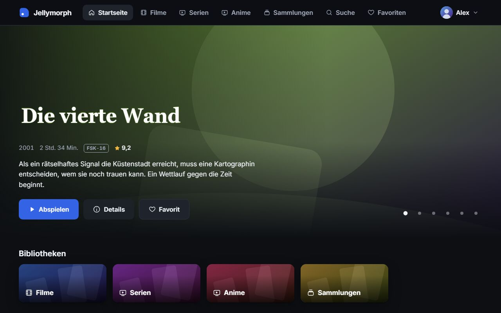
  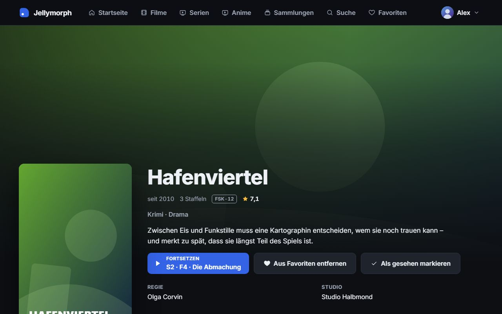
</p>

### Neon Grid

Das eigene Design des Projekts: ein futuristisches HUD mit Neonlicht, perspektivischem Raster, Glitch-Effekten, Boot-Sequenz bei der Anmeldung und einer Suche im Terminal-Stil.

<p>
  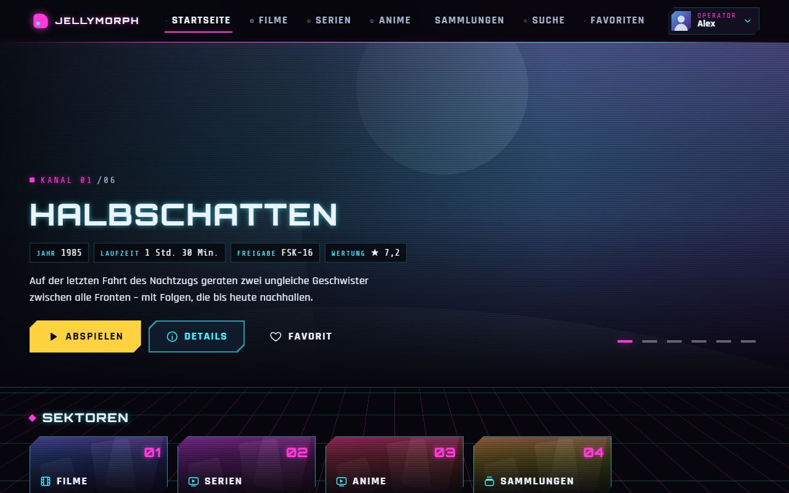
  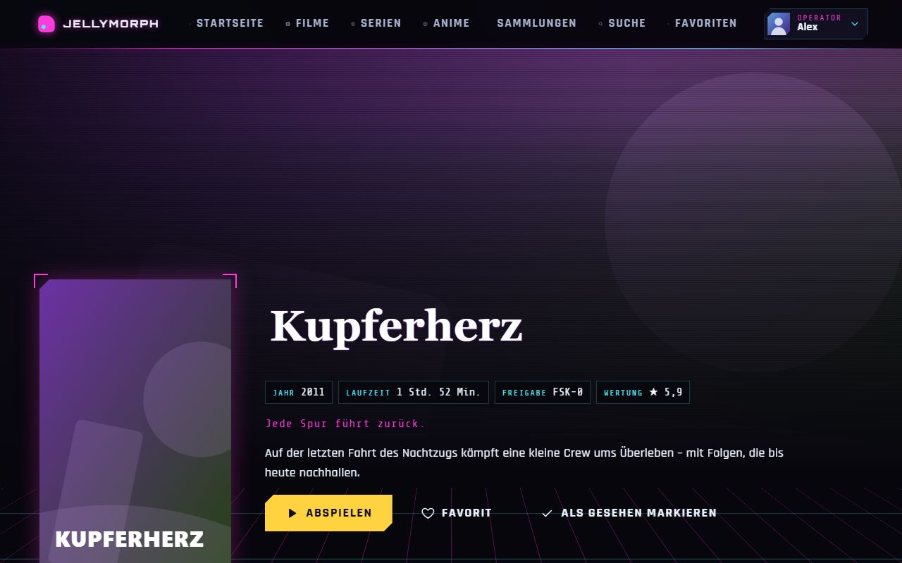
</p>

### Crimson

Großes Kino: bildfüllendes Hero mit Trailer-Vorschau, Reihen mit Vorschaukarten, Details als Fenster über der Seite und eine Profilauswahl mit großen Kacheln.

<p>
  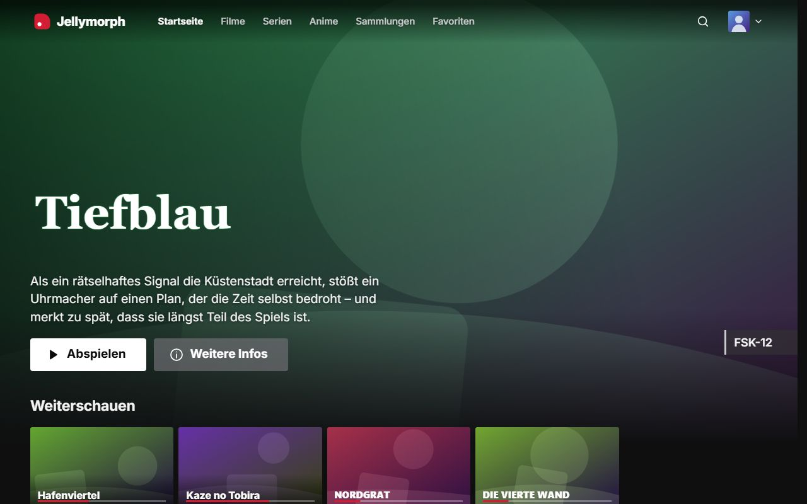
  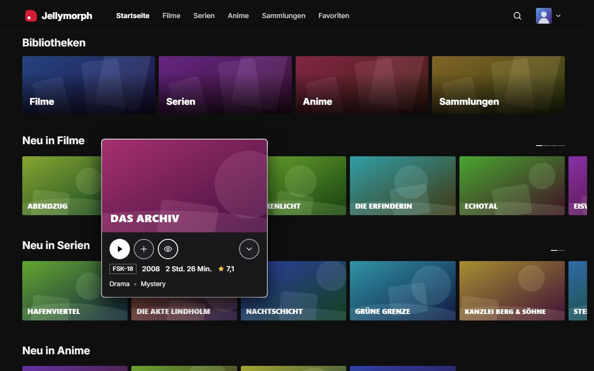
</p>

### Glass

Ruhige Milchglasflächen, ein Vollbild-Karussell und Karten, die sich bei Fokus heben und zur Maus neigen. Hell und dunkel.

<p>
  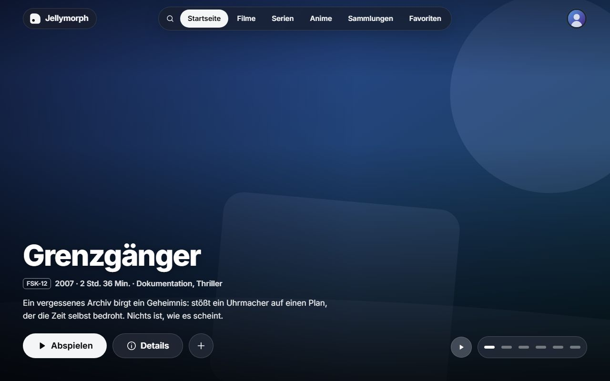
  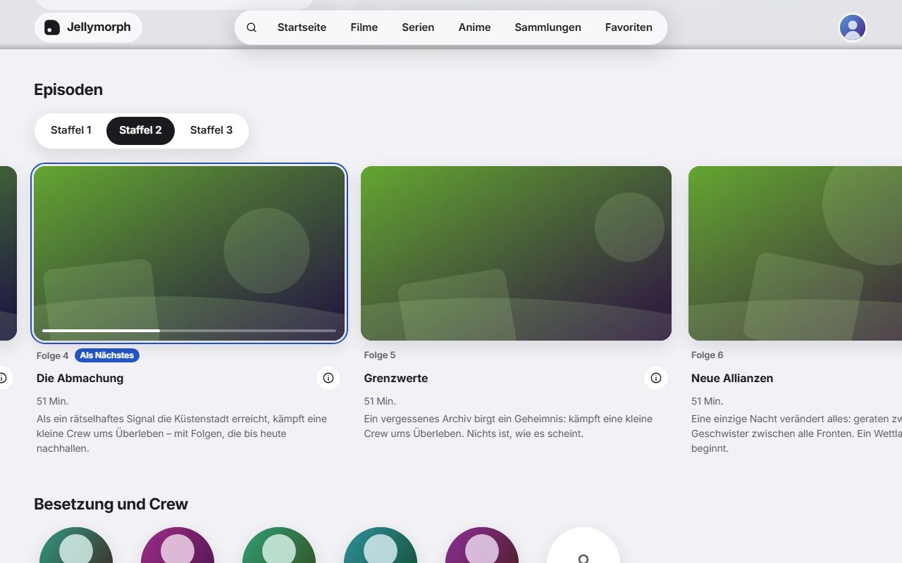
</p>

### Horizon

Klare 16:9-Reihen, Karten, die bei Fokus nach unten aufklappen, und Detailseiten mit Tabs für Episoden, Ähnliches und Details.

<p>
  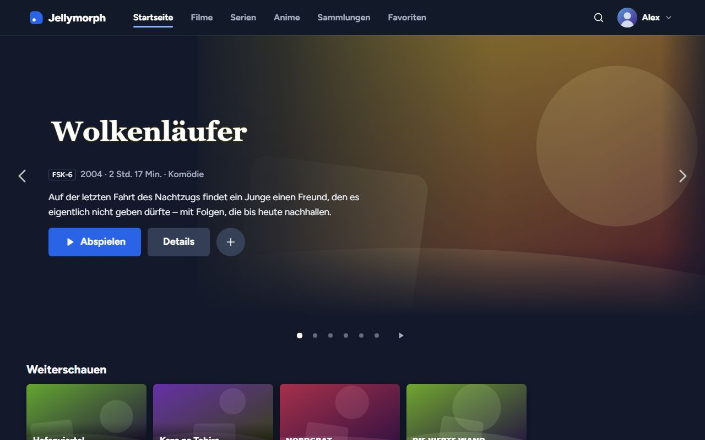
  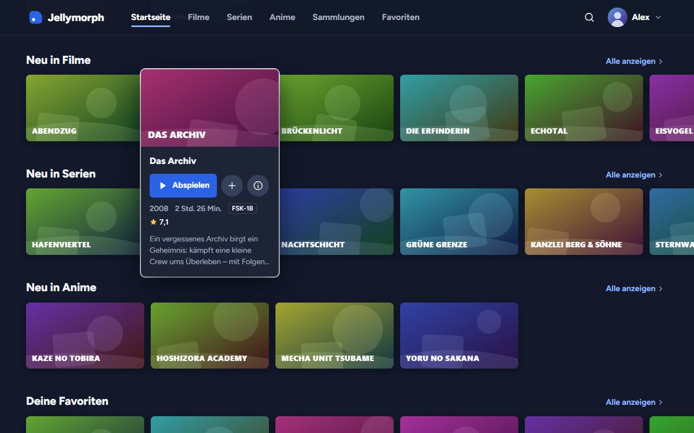
</p>

### Constellation

Ein Sternenhimmel als Hintergrund, eine Icon-Leiste, die bei Fokus aufklappt, Banner mit Nachbarn am Rand und große, leuchtende Kacheln für Bibliotheken und Sammlungen.

<p>
  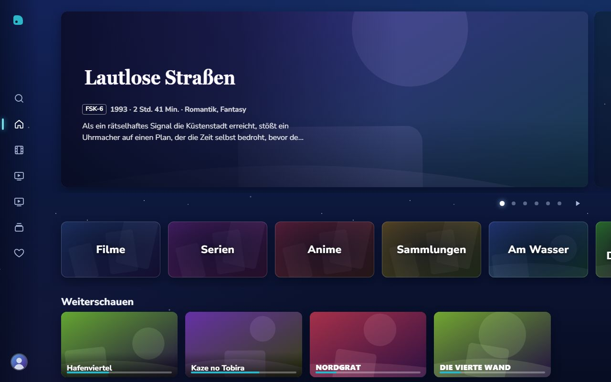
  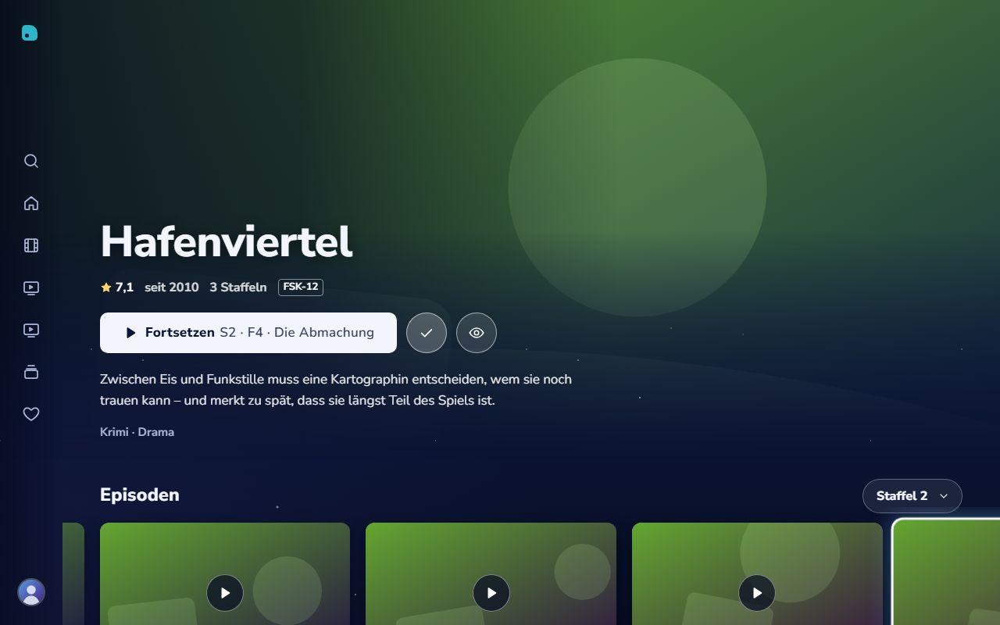
</p>

Die Bilder zeigen den Demo-Modus mit erfundenen Titeln und generierten Bildern.

## Funktionen

- **Anmeldung:** mehrere Server, Profilauswahl, Passwort oder Quick Connect. Gespeichert wird nur das Zugangs-Token, nie das Passwort.
- **Startseite:** Weiterschauen, nächste Folgen, Neues je Bibliothek, Favoriten, Sammlungen und Genres, in der Reihenfolge deiner Jellyfin-Bibliotheken.
- **Bibliotheken:** schnelles Raster auch bei tausenden Titeln, Sortierung, Filter (Genre, Jahr, gesehen, Favoriten) und eine Sprungleiste von A bis Z.
- **Details und Serien:** Besetzung, Ton- und Untertitelspuren, Trailer, Staffeln, Episoden mit Fortschritt, nächste Folge hervorgehoben. Live-Suche, nach Typ gruppiert.
- **Player:** spielt direkt ab, wo der Browser es kann, sonst über HLS-Transcoding. Ton- und Untertitelwahl (Bilduntertitel werden eingebrannt), Qualität, Geschwindigkeit, Vollbild, Bild-in-Bild, Vorschaubilder auf der Zeitleiste, „Intro überspringen“, nächste Folge mit Countdown. Der Fortschritt landet in Jellyfin, „Weiterschauen“ stimmt also auf allen Geräten.
- **Bedienung:** Maus, Touch, Tastatur und Fernbedienung. Auf Fernsehern ein TV-Modus mit größerer Schrift und einstellbarem Bildrand, in 1080p und 4K.
- **Barrierefreiheit:** Kontraste nach WCAG AA, Fokus mindestens so deutlich wie Hover, reduzierte Bewegung auf Wunsch oder nach Systemeinstellung. Jede Seite jedes Themes wird automatisch mit axe geprüft.
- **Sprachen:** Deutsch und Englisch.
- **Betrieb:** ein kleines Docker-Image für amd64 und arm64, läuft ohne Root und schreibgeschützt, mit strikter Content Security Policy.

## Betrieb mit Docker

Das Image gibt es für `linux/amd64` und `linux/arm64` (z. B. Raspberry Pi 4/5):

```bash
docker run -d --name jellymorph -p 8080:8080 \
  -e JELLYFIN_PROXY_TARGET=http://192.168.1.10:8096 \
  --read-only --tmpfs /tmp --cap-drop ALL \
  ghcr.io/lua-x/jellymorph:latest
```

Danach ist Jellymorph unter `http://<rechner>:8080` erreichbar. Ein vollständiges Beispiel für Docker Compose liegt in [docker-compose.yml](docker-compose.yml).

### Variablen

| Variable                | Zweck                                                                                                                      | Standard     |
| ----------------------- | -------------------------------------------------------------------------------------------------------------------------- | ------------ |
| `JELLYFIN_PROXY_TARGET` | Adresse deines Jellyfin-Servers. Jellymorph reicht ihn unter `/jellyfin` durch (empfohlen).                                | leer         |
| `JELLYFIN_URL`          | Server-Adresse, die bei der Anmeldung vorbelegt ist. Der Browser verbindet sich direkt.                                    | leer         |
| `LOCK_SERVER`           | `true`: Die Adresse aus `JELLYFIN_URL` ist fest und lässt sich in der App nicht ändern.                                    | `false`      |
| `DEFAULT_THEME`         | Theme für Benutzer ohne eigene Wahl: `default` (Classic), `neon-grid`, `crimson`, `glass`, `horizon` oder `constellation`. | `default`    |
| `APP_TITLE`             | Name im Browser-Tab und beim Installieren als App                                                                          | `Jellymorph` |
| `DEMO_MODE`             | `true`: Demo mit erfundenen Daten, ganz ohne Jellyfin-Server                                                               | `false`      |

Änderungen brauchen keinen neuen Build: Variable anpassen, Container neu starten. Ungültige Werte, etwa ein Tippfehler im Theme-Namen, stoppen den Container mit einer Meldung im Log (`docker logs jellymorph`), die die Variable nennt.

### Mit oder ohne Proxy

- **Mit `JELLYFIN_PROXY_TARGET` (empfohlen):** Jellyfin erscheint unter derselben Adresse wie Jellymorph. Es gibt keine CORS- oder Mixed-Content-Probleme, die Server-Auswahl entfällt, und der Browser darf ausschließlich mit Jellymorph selbst sprechen. Der Container startet auch, wenn Jellyfin noch nicht läuft, und findet einen neu gestarteten Jellyfin-Container von selbst wieder. In Kubernetes den vollständigen DNS-Namen angeben (z. B. `http://jellyfin.media.svc.cluster.local:8096`), weil nginx keine Suchdomänen kennt.
- **Mit `JELLYFIN_URL`:** Der Browser verbindet sich direkt mit Jellyfin. Läuft Jellymorph über HTTPS, muss auch Jellyfin per HTTPS erreichbar sein. Ohne `LOCK_SERVER` können Benutzer weitere Server hinzufügen.

### HTTPS, App-Installation und Sicherheit

- Für HTTPS stellst du einen Reverse Proxy (z. B. Caddy, Traefik oder nginx) vor den Container. Erst mit HTTPS (oder auf `localhost`) lässt sich Jellymorph über das Browser-Menü als App installieren, und erst dann läuft der Demo-Modus auch auf anderen Geräten.
- Jellymorph läuft als unprivilegierter Benutzer (UID 101) und braucht nur `/tmp` zum Schreiben, deshalb funktionieren `--read-only` und `--cap-drop ALL`. Der Container setzt eine strikte Content Security Policy und weitere Sicherheits-Header.
- Gesundheitsprüfung: `GET /healthz` antwortet mit `ok`. Das Image bringt einen passenden `HEALTHCHECK` mit.
- Damit Jellyfin im Proxy-Betrieb die echten Client-Adressen sieht, kannst du die Adresse des Jellymorph-Containers in Jellyfin unter _Netzwerk → Bekannte Proxys_ eintragen.

### Image-Tags

| Tag            | Inhalt                                                                   |
| -------------- | ------------------------------------------------------------------------ |
| `latest`       | neueste stabile Version                                                  |
| `1.2.3`, `1.2` | eine bestimmte Version bzw. die neueste Patch-Version                    |
| `1`            | neueste Version mit derselben Hauptversion (ab 1.0)                      |
| `edge`         | jeder Stand von `main` nach bestandener CI, nicht für den Alltag gedacht |

## Ausprobieren ohne Server (Demo-Modus)

Mit Docker:

```bash
docker run --rm -p 8080:8080 -e DEMO_MODE=true ghcr.io/lua-x/jellymorph:latest
```

Oder aus dem Quellcode:

```bash
npm install
npm run dev
```

Ohne `JELLYFIN_DEV_URL` startet die App mit einem eingebauten Mock-Server und erfundenen Beispieldaten. Das Passwort aller Demo-Profile lautet `demo`. Quick-Connect-Codes werden nach wenigen Sekunden automatisch bestätigt.

Im Demo-Modus spielt jeder Titel denselben 60-Sekunden-Clip, mit Intro, Abspann, Kapiteln, Untertiteln und Vorschaubildern. Daran lassen sich alle Player-Funktionen ausprobieren: Direct Play, HLS, Spurwechsel, „Intro überspringen“ und die nächste Folge.

## Einstellungen und Bedienung

Theme, Farbschema, Sprache, Bewegung und Trailer-Autoplay speichert Jellymorph pro Benutzer auf dem Jellyfin-Server. Sie gelten also auf allen Geräten. Ton- und Untertitelsprache, Untertitelmodus und „Nächste Folge automatisch“ stehen in deinem Jellyfin-Konto und gelten auch für die anderen Jellyfin-Apps. Streaming-Qualität, Bedienmodus und Bildrand bleiben auf dem jeweiligen Gerät.

Alles lässt sich mit Maus, Touch, Tastatur oder Fernbedienung bedienen: Pfeiltasten bewegen den Fokus, Enter wählt aus, Esc oder die Zurück-Taste gehen zurück. Auf Fernsehern schaltet Jellymorph automatisch in den TV-Modus mit größerer Schrift und einstellbarem Bildrand. In den Einstellungen lässt er sich auch fest einschalten.

## Entwicklung mit einem echten Jellyfin-Server

1. `.env.example` nach `.env.local` kopieren. Die Datei wird nicht eingecheckt.
2. `JELLYFIN_DEV_URL` auf deinen Server setzen, z. B. `http://192.168.1.10:8096`.
3. `npm run dev` starten. Der Dev-Server leitet `/jellyfin` an deinen Server weiter, so entstehen keine CORS-Probleme.

Unterstützt wird Jellyfin ab Version 10.10, auch 12.x.

## Befehle

| Befehl                               | Zweck                                                              |
| ------------------------------------ | ------------------------------------------------------------------ |
| `npm run dev`                        | Entwicklungsserver                                                 |
| `npm run build`                      | Produktions-Build nach `dist/`                                     |
| `npm run lint` / `npm run typecheck` | ESLint / TypeScript                                                |
| `npm test`                           | Unit- und Integrationstests (Vitest, MSW)                          |
| `npm run test:e2e`                   | End-to-End-Tests gegen den Build im Demo-Modus (Playwright)        |
| `npm run shots`                      | Prüf-Screenshots in vier Auflösungen nach `artifacts/screenshots/` |
| `npm run previews`                   | Vorschaubilder der Themes für die Theme-Auswahl neu erzeugen       |
| `npm run readme-shots`               | Bilder für dieses README nach `docs/screenshots/`                  |
| `npm run check:bundle`               | Größenbudget des Basis-Bundles (250 KB gzip) prüfen                |
| `node scripts/record-demo-clip.ts`   | Demo-Clip neu aufnehmen (dauert eine Minute)                       |
| `node scripts/render-icons.ts`       | App-Icons aus `public/favicon.svg` neu erzeugen                    |
| `docker build -t jellymorph .`       | Image lokal bauen                                                  |

Die Architektur beschreibt [docs/architecture.md](docs/architecture.md), wie man ein Theme baut [docs/themes.md](docs/themes.md).

## Hinweise

Die Themes orientieren sich an gängigen Streaming-Oberflächen. Jellymorph steht in keiner Verbindung zu den Anbietern dieser Dienste und beansprucht keine Markenrechte. Jellymorph ist außerdem ein inoffizieller Client und kein Projekt des Jellyfin-Teams.

## Lizenz

[AGPL-3.0](LICENSE)
